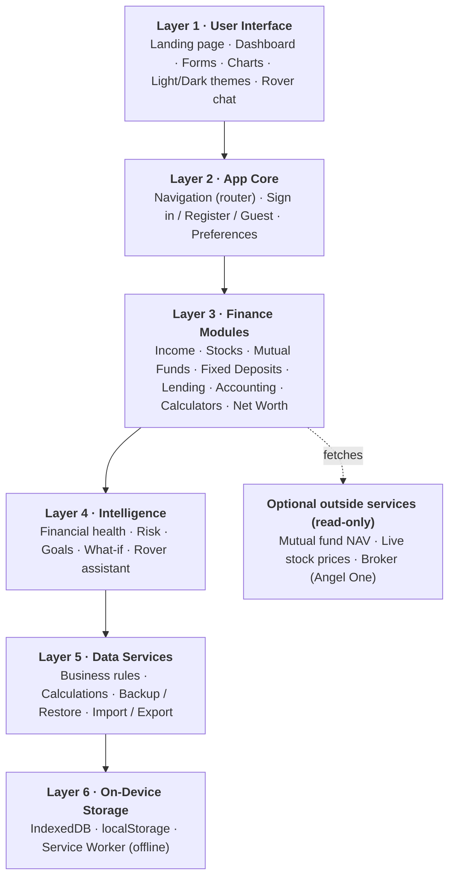
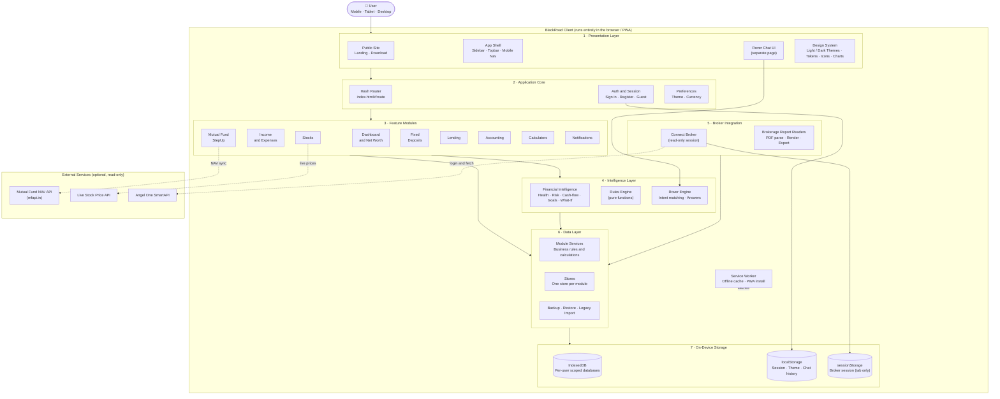
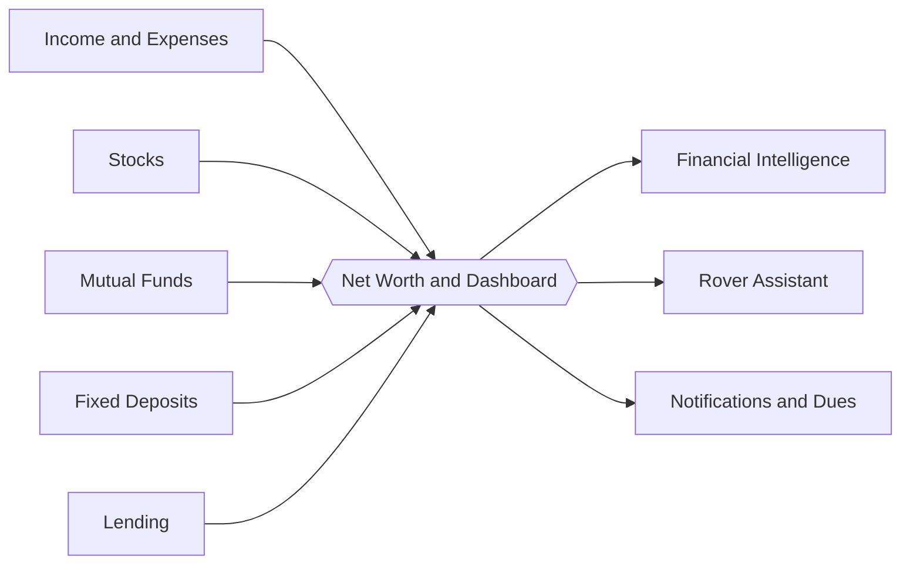
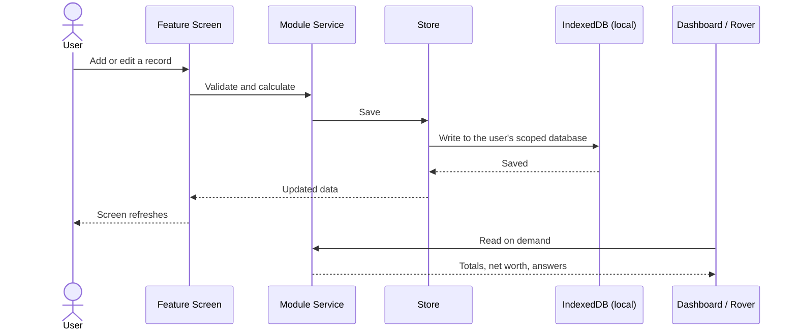

<div align="center">

# BlackRoad

### Your entire financial life. One private app.

Track income, stocks, mutual funds, deposits, loans and net worth in one place, with your data stored on your own device.


-orange)


### 🌐 [Open the Live App → microintel.github.io/blackroad-v2](https://microintel.github.io/blackroad-v2/)

</div>

---

## Table of Contents

- [Live Demo](#live-demo)
- [BlackRoad in Simple Words](#blackroad-in-simple-words)
- [Problem Statement](#problem-statement)
- [Our Solution](#our-solution)
- [Key Features](#key-features)
- [Layered Architecture](#layered-architecture-simple-view)
- [Detailed Architecture](#architecture)
- [Data Flow](#data-flow)
- [Privacy and Security](#privacy-and-security)
- [Tech Stack](#tech-stack)
- [Getting Started](#getting-started)
- [Vision](#vision)
- [Mission](#mission)
- [Roadmap](#roadmap)
- [Developed By](#developed-by)

---

## Live Demo

**https://microintel.github.io/blackroad-v2/**

Open the link on your phone or computer. You can register, sign in, or continue as a guest. On mobile or desktop you can also install it like an app (Add to Home Screen / Install).

## BlackRoad in Simple Words

Think of BlackRoad as **a digital diary for all your money**.

- You write down what you earn and spend.
- You record the shares, mutual funds and fixed deposits you own.
- You note the money you lent to or borrowed from people.

BlackRoad then adds everything up and tells you, in plain language, **how much you are worth today**, how healthy your finances are, and what changed.

**The important part:** your money data is saved **inside your own phone or computer**, not on someone else's server. That is why it is private, and why it keeps working even without internet.

You can also ask **Rover**, the built-in assistant, questions like *"How much did I spend this month?"* and it answers from your own data.

---

## Problem Statement

Managing personal money today is scattered and stressful:

- **Fragmented tools.** Income lives in one app, stocks in a broker app, mutual funds in another, fixed deposits in a bank portal, and money lent to friends in a notebook or WhatsApp chat.
- **No single net worth view.** People cannot easily answer "How much am I actually worth today?" or "Where did my money go this month?"
- **Privacy concerns.** Most finance apps need cloud accounts, upload bank and broker data to remote servers, and monetize user information.
- **Poor offline access.** Many tools stop working without internet and lock your data behind subscriptions.
- **Hard-to-read broker reports.** Brokerage P&L statements arrive as dense PDFs that are difficult to analyze.
- **Little guidance.** Raw numbers are shown, but there is no help understanding financial health, risk, goals or what changed.

## Our Solution

**BlackRoad** is a unified personal finance application that brings every part of your money into one clean, fast, private interface.

| Problem | How BlackRoad solves it |
|---|---|
| Scattered tools | One app with Income, Stocks, Mutual Funds, Fixed Deposits, Lending and Accounting modules sharing one design and one data layer |
| No net worth view | A live Dashboard and Net Worth page combine all modules into one picture |
| Privacy | All data is stored locally in the browser or device (IndexedDB). No server holds your financial records |
| Offline use | Installable as a PWA with a service worker, so it works offline |
| Broker reports | Brokerage Report Readers parse broker P&L files and present them clearly |
| Lack of guidance | Financial Intelligence (health score, cash-flow forecast, risk, goals, what-if) and **Rover**, an offline chat assistant that answers questions from your own data |
| Data lock-in | One global import/export system, with legacy backup files still accepted |

## Key Features

| Module | What it does |
|---|---|
| **Dashboard** | Live net worth, asset allocation, mutual fund profit/loss, wealth lanes and Financial Intelligence cards |
| **Net Worth** | Combined view of assets and liabilities across all modules |
| **Income and Expenses** | Ledger, income statement, statistics, search, compare, expand and jump-to, with per-income transactions and PDF export |
| **Stocks** | Transactions, live prices, P&L charts, MTF (margin) tracking and a print/PDF report |
| **Fixed Deposits** | Add, edit, close and delete deposits with maturity calculations |
| **Lending** | People ledger, loans and EMI tracking, overview of dues |
| **Mutual Fund (StepUp)** | SIP profiles, step-ups, skips, XIRR, NAV sync, goal tracking and charts |
| **Accounting** | Manual accounting records |
| **Calculators** | Finance calculators for planning |
| **Brokerage Report Readers** | Reads broker P&L statements (Angel One) and renders them cleanly |
| **Connect Broker** | Read-only connection to a broker account to view holdings, positions, funds, orders and trades |
| **Rover** | Offline chat assistant that answers questions on net worth, spending, stocks, funds, deposits and loans from on-device data |
| **Data Management** | Global backup, restore, import, export and clear data |
| **Notifications** | Reminders and dues |
| **Account and Appearance** | Sign in, register, guest mode, Light and Dark themes |

---

## Layered Architecture (Simple View)

BlackRoad is built in layers. Each layer only talks to the layer right below it, which keeps the app clean, easy to fix and easy to grow.



| Layer | In simple words |
|---|---|
| **1 · User Interface** | What you see and tap |
| **2 · App Core** | Moves you between screens and knows who you are |
| **3 · Finance Modules** | The actual money features |
| **4 · Intelligence** | Turns numbers into easy advice and answers |
| **5 · Data Services** | Does the maths and keeps data safe and portable |
| **6 · On-Device Storage** | Keeps everything on your own device |

---

## Architecture

### Detailed System Architecture



### Layer Responsibilities

| Layer | Responsibility |
|---|---|
| **Presentation** | Everything the user sees: the public site, app shell, shared theme and design system, and the Rover chat page |
| **Application Core** | Routing between screens, authentication and guest mode, user preferences |
| **Feature Modules** | The finance modules. Each owns its screen and its calculations |
| **Intelligence** | Explainable, rule-based insights and the offline Rover assistant. No data leaves the device |
| **Broker Integration** | Read-only broker connection and broker report parsing |
| **Data Layer** | Services apply business rules; stores read and write; backup and restore handle portability |
| **On-Device Storage** | IndexedDB for financial records, localStorage for light settings, sessionStorage for temporary broker sessions |

### Module and Data Relationship



## Data Flow



## Privacy and Security

- **Local-first.** Financial records live in IndexedDB on your device and are scoped per signed-in user.
- **No financial data upload.** BlackRoad does not send your records to a server.
- **Read-only broker access.** The broker connection only views data. Credentials are kept for the current tab session and cleared on logout.
- **Offline assistant.** Rover answers from on-device data.
- **You own your data.** Full backup and restore are always available.
- **Guest mode** is read-protected from writes so demo data cannot overwrite real accounts.

## Tech Stack

| Area | Technology |
|---|---|
| Frontend | HTML, CSS, Vanilla JavaScript (ES Modules) |
| Storage | IndexedDB, localStorage |
| Offline / Install | PWA (Web App Manifest + Service Worker) |
| Routing | Hash-based, so it works on any static host |
| Theming | Semantic design tokens with Light and Dark modes |
| Hosting | Any static server, including GitHub Pages |

## Getting Started

The app uses ES modules, so serve it over HTTP instead of opening the file directly.

```bash
# Clone
git clone https://github.com/microintel/blackroad-v2.git
cd blackroad-v2

# Run (any one of these)
python serve.py                  # http://localhost:8080
python -m http.server 8080       # then open /index.html
npx serve
```

Or just use the live app at **https://microintel.github.io/blackroad-v2/**.

Locally, open `http://localhost:8080` and sign in, register, or continue as a guest.

---

## Vision

> To make every person financially aware and in control by giving them one simple, private and intelligent home for their entire financial life, available on every device.

## Mission

- Bring **all personal finance tracking into one place**.
- Keep user data **private and in the user's hands**.
- Turn raw numbers into **clear, explainable insights** anyone can understand.
- Make financial tools **fast, offline-ready and free of clutter**.
- Build a product that grows from a web app into a **native experience on every platform**.

## Roadmap

| Stage | Goal | Status |
|---|---|---|
| Web app (PWA) | Full set of finance modules, themes, offline support | ✅ Live |
| Rover assistant | Offline chat over personal finance data | ✅ Live |
| Financial Intelligence | Move from example data to live user data | 🔄 In progress |
| StepUp PDF report | Export mutual fund report | 🔄 In progress |
| **Native apps** | **Android and iOS native apps, plus desktop apps for Windows, macOS and Linux** | 🚀 **Planned** |
| Multi-broker support | Reports and connections for more brokers | 🚀 Planned |
| Optional encrypted sync | Opt-in sync across devices without giving up privacy | 💡 Future |

> **Native app:** In the future, Microintel will build BlackRoad as a native app for a faster, smoother experience, with deeper device integration such as biometric lock, notifications and widgets.

## Developed By

<div align="center">

### Microintel

Building simple, private and intelligent software.

</div>

---

<div align="center">

**BlackRoad** · Developed by **Microintel**

[Live App](https://microintel.github.io/blackroad-v2/)

</div>
