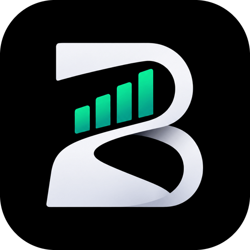
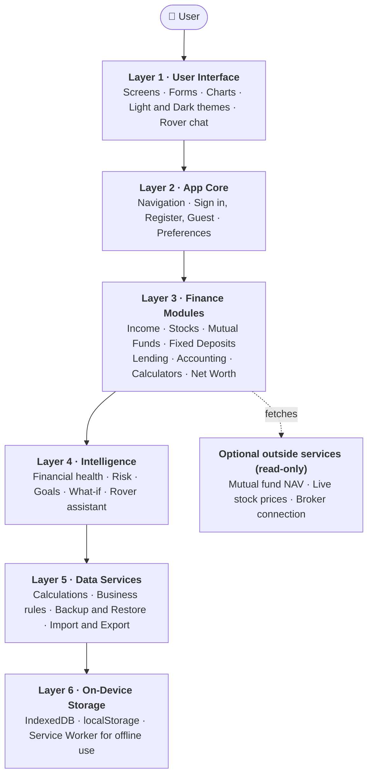
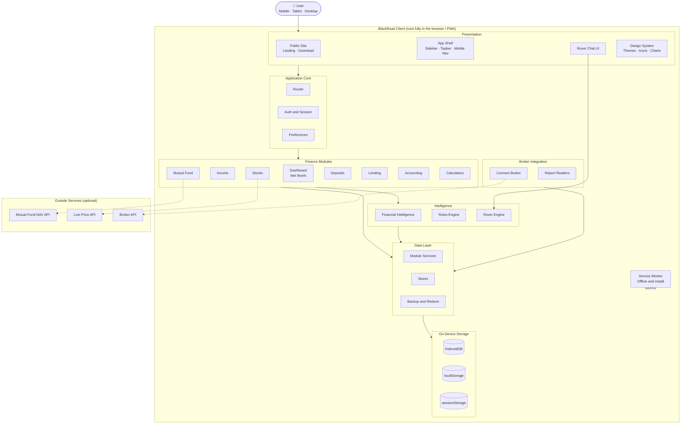
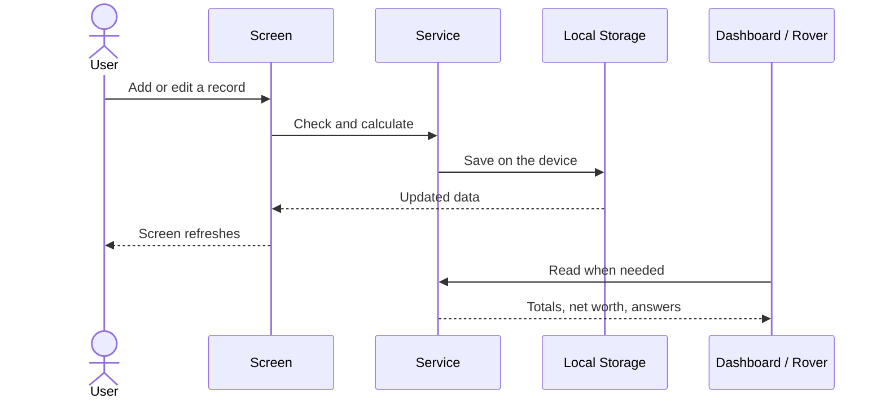
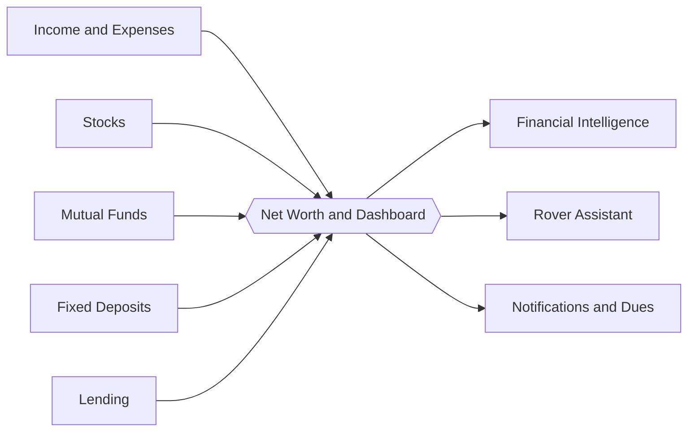
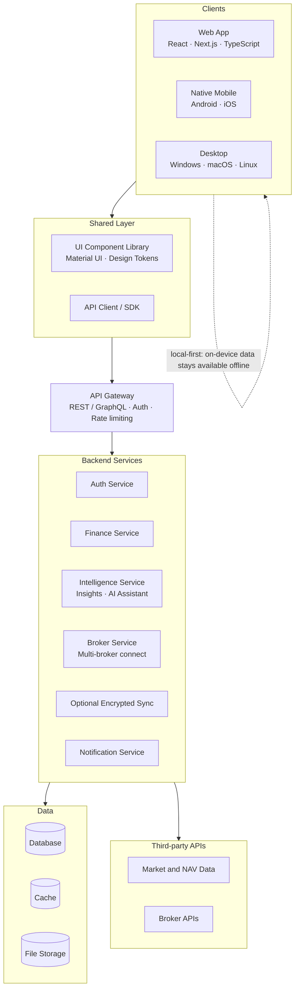

<div align="center">



# BlackRoad

**Your entire financial life. One private app.**


### 🌐 [Open the Live App → microintel.github.io/blackroad-v2](https://microintel.github.io/blackroad-v2/)

</div>

---

## What is BlackRoad?

BlackRoad is a **digital diary for all your money**.

You record what you earn, spend, own and lend. BlackRoad adds it all up and shows you how much you are worth today, how healthy your finances are, and what changed.

Your data stays **on your own phone or computer**, not on someone else's server. That keeps it private and lets the app work even without internet.

## The Problem

- Money details are scattered across many apps, bank portals and notebooks.
- There is no single place to see your real net worth.
- Most finance apps upload your private data to the cloud.
- Broker reports come as hard-to-read PDFs.
- Raw numbers are shown, but no simple guidance.

## The Solution

BlackRoad puts income, stocks, mutual funds, fixed deposits, loans and accounting into **one app**, with one clean design, local-first privacy, offline support, and a built-in assistant called **Rover** that answers questions from your own data.

---

## Layered Architecture

BlackRoad is built as a stack of layers. Each layer talks only to the layer below it, so the app stays clean, easy to fix and easy to grow.



**In simple words**

- **Layer 1** is what you see and tap.
- **Layer 2** moves you between screens and knows who you are.
- **Layer 3** holds the real money features.
- **Layer 4** turns numbers into easy advice and answers.
- **Layer 5** does the maths and keeps your data safe and portable.
- **Layer 6** stores everything on your own device.

---

## System Architecture

A closer look at how everything connects inside the app.



### How data moves



### How the modules connect



---

## Future Architecture

Today BlackRoad is a fast, private, local-first web app. As it grows, Microintel plans to build it with a modern stack: **React** for the interface, a **backend** with **APIs**, and **native apps**.



**Planned direction**

- **Frontend:** React, Next.js, TypeScript and Material UI.
- **Backend and APIs:** secure services and APIs for sign-in, optional encrypted sync and broker connections.
- **Native apps:** Android, iOS and desktop apps for a faster, smoother experience, with biometric lock, notifications and widgets.
- **Privacy stays first:** local-first design remains. Cloud sync will be optional and encrypted.

---

## Privacy

- Financial records are saved on your device, separately for each user.
- No financial data is uploaded to a BlackRoad server.
- The broker connection is read-only, and its login is cleared when you log out.
- Rover answers offline from your own data.
- You can back up and restore everything at any time.

## Getting Started

The app uses ES modules, so serve it over HTTP instead of opening the file directly.

```bash
git clone https://github.com/microintel/blackroad-v2.git
cd blackroad-v2

python serve.py                  # http://localhost:8080
# or
python -m http.server 8080
# or
npx serve
```

Or just use the live app: **https://microintel.github.io/blackroad-v2/**

---

## Vision

> To make every person financially aware and in control, by giving them one simple, private and intelligent home for their entire financial life, on every device.

## Mission

- Bring all personal finance tracking into one place.
- Keep user data private and in the user's hands.
- Turn raw numbers into clear insights anyone can understand.
- Keep tools fast, offline-ready and free of clutter.
- Grow from a web app into a native experience on every platform.

---

<div align="center">

### Developed by Microintel

Building simple, private and intelligent software.

[Live App](https://microintel.github.io/blackroad-v2/)

</div>
